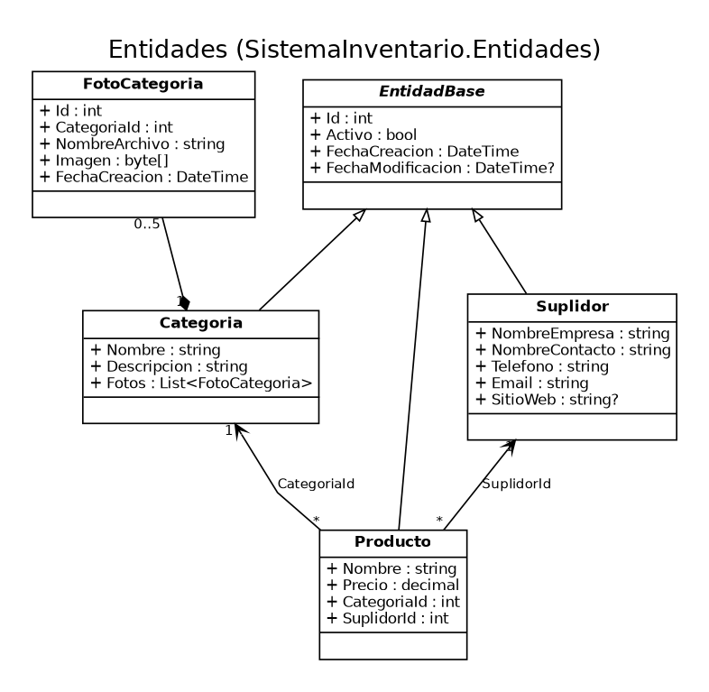

# Sistema de Inventario (Invent-Engine)

Aplicación de escritorio en **C# / Windows Forms (.NET 10)** para gestionar productos, categorías y suplidores de un inventario, con papelera (borrado lógico), reportes y gráficos. Los datos se guardan en **SQL Server** (LocalDB por defecto).

## Capturas de pantalla

<!-- Reemplaza cada línea por tu captura (guárdalas en docs/capturas/) -->
| Inicio | Productos |
|---|---|
| ![Inicio] 
| ![Productos] |

| Categorías | Suplidores |
|---|---|
| ![Categorías] 
| ![Suplidores]  |

| Papelera | Reportes |
|---|---|
| ![Papelera]   
|  y suplidores.
- Búsqueda en tiempo real y filtros combinables en productos (categoría, suplidor y rango de precio).
- Papelera: los registros eliminados se pueden restaurar (con validación de dependencias).
- Panel de inicio con indicadores y gráficos; reportes con tabla y gráfico.
- Validaciones por campo (teléfono dominicano 809/829/849, correo, URL, precios con 2 decimales).
- Registro de errores técnicos en `errores.log` junto al ejecutable.

## Requisitos

- Windows 10/11
- [.NET 10 SDK](https://dotnet.microsoft.com/download) (para compilar) o el runtime de **.NET 10 Desktop** (para ejecutar `/build`)
- SQL Server LocalDB (incluido con Visual Studio) o cualquier instancia de SQL Server
- Visual Studio 2022/2026 con la carga de trabajo *Desarrollo de escritorio con .NET* (opcional)

## Instalación

### 1. Crear la base de datos

Ejecuta los scripts en este orden (desde SSMS, Azure Data Studio o `sqlcmd`):

```powershell
sqlcmd -S "(localdb)\MSSQLLocalDB" -I -i database\schema.sql
sqlcmd -S "(localdb)\MSSQLLocalDB" -I -i database\datos.sql
```

- `schema.sql` crea la base `SistemaInventario` y sus tablas (es re-ejecutable: borra y recrea).
- `datos.sql` carga datos de prueba. Use `-I` para activar `QUOTED_IDENTIFIER`.

### 2. Configurar la conexión

La cadena de conexión está en `src/SistemaInventario.Presentacion/Program.cs`:

```csharp
Server=(localdb)\MSSQLLocalDB;Database=SistemaInventario;Trusted_Connection=True;TrustServerCertificate=True;
```

Cámbiala si usas otra instancia de SQL Server.

### 3. Compilar y ejecutar

```powershell
cd src
dotnet build SistemaInventario.sln -c Release
dotnet run --project SistemaInventario.Presentacion
```

O abre `src/SistemaInventario.sln` en Visual Studio y presiona **F5**.

### Ejecutable compilado

La carpeta `build/` contiene la versión Release. Se genera con:

```powershell
cd src
dotnet publish SistemaInventario.Presentacion -c Release -r win-x64 --self-contained false -o ..\build
```

Ejecuta `build\SistemaInventario.Presentacion.exe` (la base de datos debe existir).

## Arquitectura

Solución en **4 capas**, con dependencias en un solo sentido (Presentación → Lógica de negocio → Acceso a datos → Entidades):

| Proyecto | Responsabilidad |
|---|---|
| `SistemaInventario.Entidades` | Clases del dominio (`Categoria`, `Producto`, `Suplidor`, `FotoCategoria`) sobre `EntidadBase` (Id, Activo, fechas). |
| `SistemaInventario.AccesoDatos` | ADO.NET con `Microsoft.Data.SqlClient`. `RepositorioBase<T>` genérico con borrado lógico, `ConexionBD` (singleton), `Logger`. |
| `SistemaInventario.LogicaNegocio` | Servicios, validaciones (`Validador`), `Resultado<T>` para devolver éxito o errores por campo, y `FabricaServicios` que compone las capas. |
| `SistemaInventario.Presentacion` | Windows Forms: `FormPrincipal` con menú lateral, vistas (`UserControl`), formularios de edición y controles de estilo reutilizables. |

Cada formulario/vista separa la **lógica** (`Nombre.cs`) del **diseño visual** (`Nombre.Designer.cs`), por lo que se puede abrir en el diseñador de Visual Studio.

```
SistemaInventario/
├── README.md
├── src/        código fuente de la solución
├── database/   schema.sql y datos.sql
├── docs/       diagramas ER y de clases (UML)
└── build/      ejecutable compilado en Release
```

## Diagramas

- **Entidad-relación:** [`docs/diagrama-er.png`](docs/diagrama-er.png)
- **Clases (UML):**
  [entidades](docs/diagrama-clases-entidades.png) ·
  [acceso a datos](docs/diagrama-clases-datos.png) ·
  [lógica de negocio](docs/diagrama-clases-negocio.png) ·
  [presentación](docs/diagrama-clases-presentacion.png)
  (fuentes Graphviz en `docs/fuentes-uml/`)



## Solución de problemas

- *No se pudo conectar con la base de datos:* verifica que LocalDB esté iniciado (`sqlcmd -S "(localdb)\MSSQLLocalDB" -Q "SELECT 1"`) y que ejecutaste `schema.sql`.
- Los detalles técnicos de cualquier error quedan en `errores.log`, junto al ejecutable.
